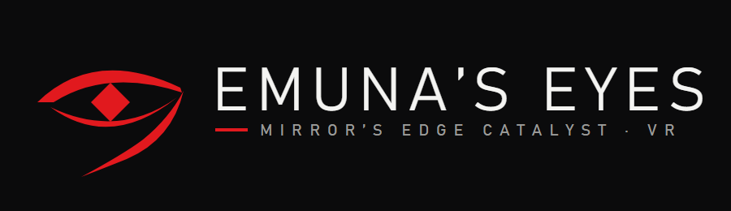
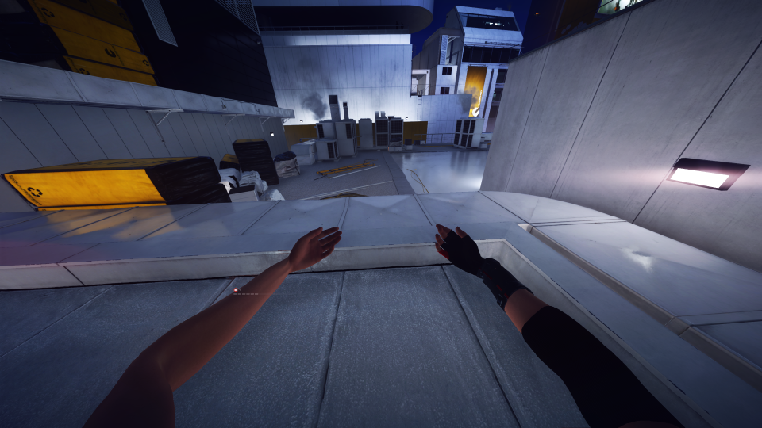

<p align="center">
  
</p>

<p align="center">
  <b>A full 6DoF motion-controller VR mod for Mirror's Edge Catalyst.</b><br>
  True 3D, head tracking, and Faith's own arms, hands and fingers following yours.
</p>

<p align="center">
  Version 0.1.0 · Steam build 1.0.3.47248 · Windows · OpenXR (SteamVR) · MIT
</p>

<p align="center">
  <br>
  <sub>In the headset: Faith's own arms reach out where your hands are.</sub>
</p>

---

Emuna's Eyes is a fan-made mod. It is not made, endorsed or supported by EA or DICE.
It is single-player only. It doesn't touch the game's DRM, the license token or the EA login, and it ships only its own files: no game files are included or changed, and uninstalling puts the game back exactly as it was.

## Features

### See it in VR
- **True 3D:** each eye gets its own picture, and the headset's full field of view is filled.
- **1:1 head tracking (6DoF).** The camera never moves you on its own: no forced rolls or bobbing.
- **Sharp anti-aliasing in 3D.** The game's TAA history is kept per eye, so there's no shimmer or ghosting between the eyes.
- **Eye sync:** the world holds still while the second eye is drawn, so both eyes always see the same moment.
- **Optional game camera motion** (F5 or the menu): adds the game's rolls, wall-run tilt and landing dips for players used to VR. Small fast shake (the train) is smoothed out.

### Move like a runner
- **Motion controllers play the whole game:** move, turn, jump, slide, Shift, attack, interact, Runner Vision, the map and pause.
- **Real crouching** slides or crouches Faith.
- **Room-scale:** real steps move Faith, and walls stop your view.
- **Smooth or snap turning**, recentring (hold the right stick click), and an eye-height offset.
- **Left-handed mode** mirrors the whole layout.
- **Vibration** for hits and contact.

### Fight with your body
- **Punch** for a light attack. **A hook** is a heavy attack.
- **An open-hand push** fires the Disruptor.
- **Throw a hand up** past your chin to fire the MAG Rope, and lower it to let go.
- **Shift by moving:** a quick lean or step sideways or back.
- **Touch to interact:** press a hand against a door, button or panel. Flick into a door to slam it.
- Every gesture is a setting, and the buttons always keep working too.

### Your body is Faith's body
- **Faith's own arms follow yours**, with natural elbows and forearm twist. The mod learns her skeleton from the first seconds of play.
- **Her fingers follow yours:** the index finger from the trigger, the others from the grip.
- **Hands stop at walls and objects** with a short buzz.
- On ledges, pipes, ladders and ziplines her arms play the game's animation, so climbing still looks right.
- Works in her jacket in the first mission as well as in free roam.

### HUD, menus and cutscenes
- **HUD pulled in** from the edges you can't see in a headset. The health bar and the "KSEC Responding" alerts are moved and resized.
- **Menus, the map and mission select** on a big flat screen in front of you.
- **Cutscenes in 3D** around you, or on the big screen if you prefer.
- Sound turns with your head, and the button prompts match the Touch buttons.

### In-VR settings menu
- **Hold both stick clicks for 1 second** to open it. Every setting is there, applies at once and is saved.
- **4 profiles** for different players sharing a headset.
- Reset per section or reset everything. Both ask twice.
- Settings are also in `mecvr\config.json`, which you can edit while the game runs.

### Safe by design
- **Safe mode:** on an unknown game version, the game runs flat and the mod does nothing.
- An empty `SAFE_MODE` file in the `mecvr` folder turns the mod off.
- **F11** writes a bug report with your settings. A headset screenshot is Y+B held together.
- One-click install that finds the game through Steam, and an uninstall that puts the game's own `NvCameraSDK64.dll` back.

## Requirements

- **Mirror's Edge Catalyst, Steam version 1.0.3.47248.** Turn off automatic updates in Steam so an update doesn't make the mod step aside.
- **SteamVR** set as the OpenXR runtime.
- **A PC VR headset with two tracked controllers.** It was developed on a Meta Quest 2 with Touch controllers over Steam Link. Valve Index controllers have bindings but haven't been tested.
- **A strong GPU.** It was tested on a GTX 1080 Ti at 2880x1620 (NVIDIA DSR).

## Install

Download the zip from Releases, extract it, and double-click **Install.bat**. The full guide, with controls, the settings menu, known issues and how to report a bug, is in [`dist/README.md`](dist/README.md). That file also ships inside the zip.

## Controls (Meta Touch)

| | Left hand | Right hand |
|---|---|---|
| Stick | Move | Turn |
| Stick click | Tap: pause · Hold 1 s: map | Tap: Runner Vision · Hold 1 s: recentre |
| Grip | Up actions (jump, climb) | Quick turn |
| Trigger | Down actions (slide, crouch) | Shift |
| X / A | Light attack | Interact |
| Y / B | Heavy attack | Disruptor |

Both sticks clicked in and held for 1 second open the settings menu.

## Known issues

- Faith's body is sometimes briefly out of place relative to your head.
- In her jacket (the first mission), her fingers keep the game's pose.
- Runner Vision, objective and enemy markers, and subtitle size haven't been fully checked in the headset.
- Performance hasn't been tuned yet.
- Only Meta Touch controllers have been tested.

## Building from source

You need Visual Studio 2022 or newer (it's developed with Visual Studio 2026), with the C++ desktop workload and MASM, and CMake 3.24+.

```powershell
cmake -S . -B build -A x64
cmake --build build --config Release
ctest --test-dir build -C Release            # unit tests (no game needed)
powershell -File tools\deploy.ps1            # copy the build into your game folder
powershell -File tools\undeploy.ps1          # take it out again
powershell -File tools\package.ps1 -Version 0.1.0   # release zip -> out\
```

### Layout

| Path | What's in it |
|---|---|
| `src/` | The mod: hooks, camera, stereo, OpenXR input, gestures, arm IK, UI, settings menu |
| `tests/` | Unit tests for the parts that don't need the game |
| `config/` | Default settings, the settings schema, controller bindings, and `manifest.json` (game-specific data) |
| `dist/` | Installer, uninstaller and the end-user README |
| `tools/` | Deploy, package and analysis tools |
| `docs/` | The phase plan, decisions log, bug list and playtest notes |

## Credits

Made by Nirally with Claude (Anthropic).
Uses [MinHook](https://github.com/TsudaKageyu/minhook) (BSD-2-Clause), [nlohmann/json](https://github.com/nlohmann/json) (MIT) and the [Khronos OpenXR loader](https://github.com/KhronosGroup/OpenXR-SDK) (Apache-2.0).

Mirror's Edge and Mirror's Edge Catalyst are trademarks of Electronic Arts Inc. This project is not affiliated with EA or DICE.

## License

[MIT](LICENSE). The third-party code in `third_party/` keeps its own licenses.
